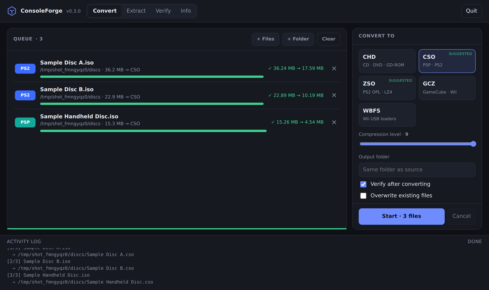

# ConsoleForge

Convert, extract and verify console disc images — **CHD, CSO, ZSO, GCZ and WBFS** — from one tool, through a local web UI or a command line. Pure Python; nothing to install beyond Python itself.



<!-- Optional: two or three sentences, in your own words, on why this exists. -->

**Status: beta (0.3.1).** Every format the tool writes has been opened in at least one emulator by the author. The table below says exactly what has and has not been tested, and [COMPATIBILITY.md](COMPATIBILITY.md) tracks it per emulator version.

## What it does

| Format | Typical use | Read | Write | Notes |
|---|---|:-:|:-:|---|
| **CHD** (v5) | PS1, PS2, Dreamcast and other disc systems | ✓ | ✓ | Writes from ISO (DVD or CD layout), BIN/CUE (multi-track, pregaps) and GDI. Reads `lzma`, `zlib`, `cdlz`, `cdzl`, `cdfl` and `flac` (`flac` has only been tested against a synthetic stream). |
| **CSO** | PSP, PS2 | ✓ | ✓ | Deflate, 2048-byte blocks. |
| **ZSO** | PS2 (OPL, PCSX2) | ✓ | ✓ | LZ4. Install the `lz4` module for usable speed (see below). |
| **GCZ** | GameCube, Wii (Dolphin) | ✓ | ✓ | zlib with a per-block Adler-32. |
| **WBFS** | Wii (USB loaders, Dolphin) | ✓ | ✓ | One disc per file, optional 4 GB split for FAT32, optional scrubbing. |

Also:

- **Platform detection.** PS1, PS2 and PSP images are recognised from their ISO 9660 contents, Wii and GameCube from the disc header. The UI uses this to suggest sensible target formats and warns when a target is unusual for a disc.
- **Conversion between containers**, for example CSO → ZSO or ZSO → CHD. This goes through a temporary ISO, so you need free disk space roughly equal to the uncompressed image.
- **Batch queue**, multi-threaded compression, cancel, and clean-up of partial output on failure.

## Quick start

Requires **Python 3.9 or newer**. There are no required third-party packages.

```sh
python consoleforge.py            # opens the web UI in your browser
```

Command line:

```sh
python consoleforge.py convert game.iso --to cso --verify
python consoleforge.py convert game.cue --to chd --verify
python consoleforge.py convert wii.iso  --to wbfs --split
python consoleforge.py extract game.chd -o out/
python consoleforge.py verify  game.cso
python consoleforge.py info    game.chd
python consoleforge.py detect  *.iso
```

Run `python consoleforge.py convert --help` for every option.

**Windows executable:** see [BUILDING.md](BUILDING.md). The build is not code-signed, so Windows SmartScreen will warn on first run.

### Optional packages

| Package | Why |
|---|---|
| `lz4` | Fast ZSO. Without it ZSO falls back to a pure-Python LZ4 codec that is correct but far slower. |
| `pywebview` | A native window instead of a browser tab. Experimental; the author has not tested this path. |
| `pycryptodome` | Faster AES, used automatically if present (only relevant to Wii scrubbing). |

## How results are verified

`--verify` (and the **Verify after converting** checkbox) re-reads the output and checks it against the source:

- **CSO, ZSO, GCZ, WBFS `full`:** the output is decompressed and compared byte for byte with the source image.
- **GCZ** additionally checks an Adler-32 on every block when reading.
- **CHD:** every hunk's CRC-16 is checked, and the decompressed data is hashed and compared with the SHA-1 stored in the CHD header.
- **WBFS `scrub` / `game`:** every sector the game actually uses must be identical to the source; sectors that were deliberately dropped must read as zeros.

Extraction is bit-exact for everything except WBFS `scrub` / `game`, which remove data by design (below).

## Wii: WBFS modes and keys

| Mode | What it keeps |
|---|---|
| `full` | Every block. The extracted ISO is identical to the original. |
| `game` | Drops the update partition and space outside the partitions, using the (unencrypted) partition table. Needs no key. |
| `scrub` | Also drops unused clusters *inside* the game partition by reading its file system table. Needs your Wii common key. |

The default is `scrub` if a key is available, otherwise `game`.

ConsoleForge does not include any key. Provide yours at run time, in one of these ways:

```sh
python consoleforge.py convert wii.iso --to wbfs --common-key <32 hex characters>
# or: environment variable WII_COMMON_KEY
# or: a wii_keys.txt next to the program containing the line  common = <32 hex characters>
```

The UI has a field for it. The key is kept in memory only and is never written to `settings.json` or anywhere else on disk.

Safeguards, because a bad scrub corrupts a game silently:

- Every decrypted cluster is checked against its H0 hash, so a wrong key or a misread is caught immediately.
- If a partition cannot be analysed, it is stored **whole** with a warning, never dropped.
- A small number of games read data that is not listed in the file system table. If a scrubbed game misbehaves, redo it with `--wbfs-mode game`.

## Compatibility

Tested by the author:

| Conversion | Played in | Result |
|---|---|---|
| PS2 DVD ISO → CHD | PCSX2 | Works |
| PS2 ISO → ZSO | PCSX2 | Works |
| PS1 BIN/CUE (data + audio track) → CHD | DuckStation | Works; CD audio plays correctly |
| PSP ISO → CSO | PPSSPP | Works |
| Wii ISO → WBFS (`game` mode) | Dolphin | Works |
| Wii / GameCube ISO → GCZ | Dolphin | Works |
| CHD made by `chdman` → ISO (a data disc whose hunks include FLAC) | — | Extracts without errors |

**Not yet tested — reports are wanted:**

- ZSO on real OPL, and WBFS split files on a USB loader.
- WBFS `scrub` mode on a retail disc.
- Dreamcast GDI → CHD in Flycast (it converts; the result has not been confirmed).
- `chdman verify` on CHDs written by ConsoleForge. Emulators do not check the header SHA-1, `chdman` does.
- Audio tracks from CHDs made by `chdman`, extracted with ConsoleForge, compared against the original dump.
- DVD CHDs made by `chdman createdvd`, which can use the plain `flac` codec for some hunks.
- Korean and vWii Wii discs; PS2 games that ship on CD.

## Known limitations

- **CHD:** version 5 only. Cannot read the `huff` or `avhu` codecs, parent/delta CHDs, or subcode data. When writing, audio is compressed with the same codecs as data (no FLAC), so CHDs of audio-heavy discs come out larger than `chdman`'s.
- **WBFS:** one disc per file. The original ISO size is recorded in a private field that other tools ignore; WBFS files from other tools are read as standard 4.7 GB / 8.5 GB Wii discs.
- **Speed:** this is pure Python. The compressors release the GIL, so throughput scales with threads, but expect it to be slower than native tools. On synthetic, highly compressible data a CD → CHD conversion ran at about 16 MB/s on one core; real discs compress worse and will be slower. <!-- TODO: add your own timing, e.g. "4.3 GB PS2 DVD → CHD in N minutes on <CPU>". -->
- **PBP/EBOOT, RVZ, NSZ and other formats** are not implemented.

## Security and privacy

The web UI is a small HTTP server bound to `127.0.0.1`. Each session uses a random token and the server rejects requests whose `Host` header is not local, so other web pages cannot drive it. ConsoleForge makes no network requests of its own and has no telemetry. It reads and writes only the paths you select.

## Running the tests

The tests use synthetic data only. No ROMs, BIOS files or keys are involved.

```sh
python test_formats.py      # CSO, ZSO, GCZ, WBFS, LZ4
python test_chd.py          # CHD CD/DVD/GDI round trips
python test_flac.py         # FLAC decoder; needs ffmpeg on PATH as the reference encoder
python test_wii.py          # encrypted-partition scrubbing with a test-only key
python test_app.py          # detection, conversion between containers, CLI
python test_web.py          # local server and API
python test_lifecycle.py    # frozen-app paths, idle shutdown, settings
```

`test_wii.py` cross-checks the built-in AES against the `cryptography` package when it is installed.

## Contributing

Compatibility reports are the most useful contribution. Please include the ConsoleForge version, your OS, the command or UI options you used, the output of `python consoleforge.py info <file>`, and the emulator or loader with its version.

For code changes, run the tests above first and keep new tests free of copyrighted data. If you port behaviour from another project, say so in the pull request, because license compatibility matters.

## Credits and independence

The formats here are implemented from public specifications and documentation and checked by testing, not by copying code. ConsoleForge is not affiliated with or endorsed by MAME, Dolphin, PCSX2, PPSSPP or any other project named in this document.

Thanks to the MAME team for the CHD format and `chdman`, to the authors of `libchdr`, `libwbfs` and Dolphin for documenting and implementing the formats it targets, and to the FFmpeg project, whose FLAC encoder is used as the reference in the test suite. AES is checked against the FIPS-197 and NIST SP 800-38A test vectors.

## Legal

ConsoleForge is meant for making backups of discs you own. It contains no games, BIOS files or encryption keys, and you are responsible for complying with the laws that apply to you.

## License

<!-- Choose a license and add a LICENSE file, then name it here (for example: MIT). -->
